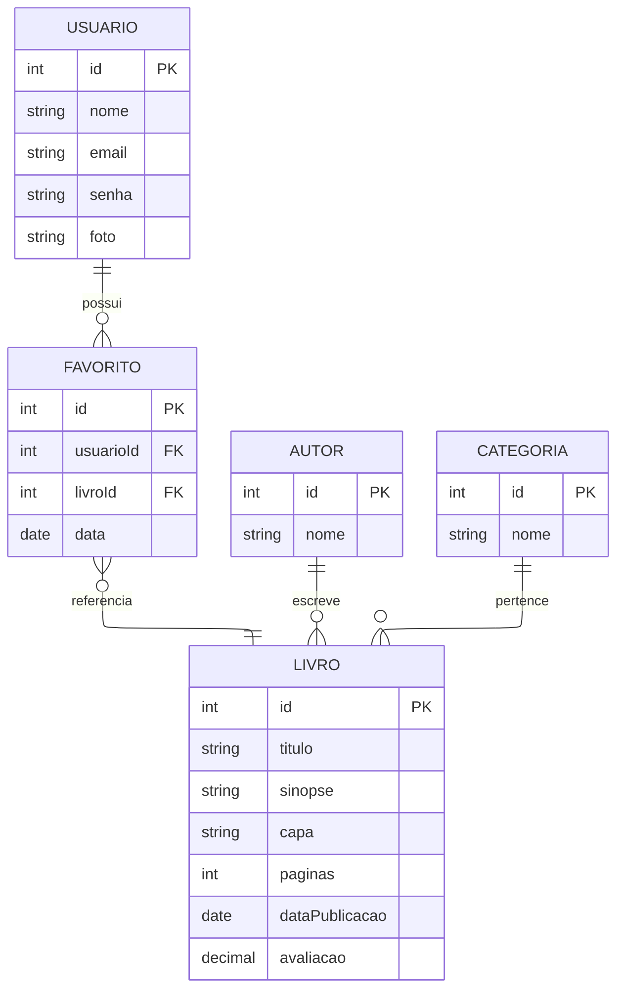
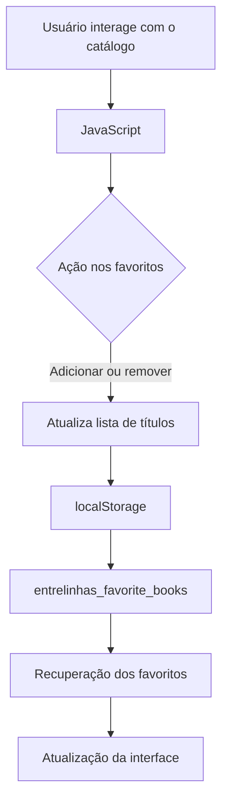

# Especificação Técnica (Tech Spec) — EntreLinhas

## 1. Visão Geral da Arquitetura

O EntreLinhas é um protótipo de uma plataforma de catálogo literário, desenvolvido para permitir a visualização, pesquisa e organização de livros.

A aplicação utiliza uma arquitetura front-end, construída com HTML, CSS, JavaScript e Bootstrap. 

O catálogo apresenta informações de livros em páginas HTML, enquanto os favoritos são armazenados localmente no navegador por meio da Web Storage API (`localStorage`).

A arquitetura foi organizada para permitir futuras evoluções, como integração com APIs externas, autenticação de usuários e armazenamento persistente em um banco de dados.

### 1.1. Funcionamento atual

- **Catálogo:** apresenta livros e suas informações nas páginas da aplicação.
- **Favoritos:** permite adicionar e remover livros de uma lista armazenada no `localStorage`.
- **Pesquisa e filtros:** permitem interagir com os livros apresentados no catálogo.
- **Login e registro:** possuem telas demonstrativas, mas não realizam autenticação ou cadastro real.
- **Dados:** não existe banco de dados próprio nem utilização de JSON Server nesta versão.

## 2. Tecnologias Utilizadas

### 2.1. Estrutura e interface

| Tecnologia | Utilização |
|---|---|
| HTML5 | Estrutura e organização semântica das páginas. |
| CSS3 | Estilização e personalização dos componentes. |
| JavaScript | Interações do catálogo, filtros e gerenciamento de favoritos. |
| Bootstrap 5.3.8 | Framework CSS utilizado para layout, grid e componentes responsivos. |
| Sass (SCSS) | Pré-processador CSS utilizado para variáveis, mixins e funções reutilizáveis. |


Abaixo está o Diagrama Entidade-Relacionamento (DER) que representa a estrutura do nosso "banco de dados" (`db.json`) e como as informações se conectam.



### 2.2. Armazenamento

**Web Storage API — localStorage**

Utilizada para armazenar a lista de livros favoritados no navegador do usuário.

O armazenamento é feito localmente, sem comunicação com um servidor ou banco de dados.

### 2.3. Ferramentas de desenvolvimento

- Node.js e NPM: gerenciamento de dependências e execução de scripts do projeto.
- Git e GitHub: controle de versão e hospedagem do código-fonte.

## 3. Design Tokens (Sistema de Design)

O projeto utiliza Design Tokens para centralizar valores visuais e manter a consistência da interface.

Esses valores estão definidos principalmente no seletor `:root` do arquivo `assets/css/style.css`, utilizando propriedades personalizadas do CSS.

### 3.1. Cores

| Token | Valor | Aplicação |
|---|---|---|
| `--color-primary` | `#9f3c16` | Cor principal da identidade visual. |
| `--color-primary-hover` | `#7f3012` | Estado de interação da cor principal. |
| `--color-primary-accent` | `#c65b2a` | Destaques e elementos de ênfase. |
| `--color-primary-fixed` | `#f5e3da` | Fundos suaves relacionados à cor principal. |
| `--color-secondary` | `#545f73` | Elementos e textos secundários. |
| `--color-background` | `#f8f5f0` | Fundo geral da aplicação. |
| `--color-surface` | `#ffffff` | Superfícies de cards e componentes. |
| `--color-surface-low` | `#f8f5f0` | Superfícies de menor destaque. |
| `--color-text` | `#292929` | Texto principal. |
| `--color-text-muted` | `#777777` | Textos auxiliares e secundários. |
| `--color-border` | `#e4e2de` | Bordas e divisórias. |

### 3.2. Tipografia

| Token | Valor | Aplicação |
|---|---|---|
| `--font-primary` | `"Plus Jakarta Sans", sans-serif` | Fonte principal da aplicação. |
| `--font-heading` | `"Playfair Display", serif` | Títulos e cabeçalhos. |
| `--font-body` | `"Plus Jakarta Sans", sans-serif` | Textos e conteúdos. |
| `--font-display` | `"Playfair Display", serif` | Elementos tipográficos de destaque. |

### 3.3. Espaçamentos e bordas

| Token | Valor | Aplicação |
|---|---|---|
| `--spacing-sm` | `0.5rem` | Espaçamento pequeno. |
| `--spacing-md` | `1rem` | Espaçamento médio. |
| `--spacing-lg` | `2rem` | Espaçamento grande. |
| `--border-radius` | `0.75rem` | Arredondamento padrão de componentes. |

### 3.4. Responsividade tipográfica

O projeto também utiliza a função CSS `clamp()` para adaptar o tamanho de alguns títulos conforme a largura da tela.

Exemplos encontrados em `assets/css/style.css`:

- `.page-title`: `clamp(1.8rem, 4vw, 3rem)`.
- `.section-title`: `clamp(1.3rem, 2.5vw, 2rem)`.
- `.card-title`: `clamp(1rem, 1.5vw, 1.25rem)`.

## 4. Modelo de Dados e Armazenamento

O projeto não possui banco de dados relacional ou banco de dados próprio nesta versão.

As informações do catálogo são apresentadas nas páginas HTML, enquanto a lista de favoritos é armazenada no navegador por meio do `localStorage`.

### 4.1. Estrutura dos favoritos

O armazenamento utiliza a seguinte chave:

`entrelinhas_favorite_books`

O conteúdo salvo é uma lista de títulos de livros em formato JSON.

Exemplo ilustrativo:

```json
[
  "Dom Casmurro",
  "1984",
  "Duna"
]
```

O JavaScript utiliza as funções `getItem()` e `setItem()` para recuperar e salvar essas informações.

### 4.2. Representação do armazenamento



### 4.3. Regras de funcionamento

- Um livro pode ser adicionado ou removido da lista de favoritos.
- A lista é armazenada no navegador utilizado pelo usuário.
- Os dados permanecem disponíveis após atualizar ou fechar a página, desde que os dados locais do navegador não sejam apagados.
- Não existe sincronização entre diferentes dispositivos ou navegadores.
- Não há associação dos favoritos a uma conta de usuário.

## 5. Integração com APIs Externas

A Open Library foi definida como uma possível fonte externa de informações bibliográficas para o catálogo.

Seus endpoints de pesquisa permitem consultar livros por termos gerais, título ou autor.

Exemplos de endpoints documentados:

| Método | Endpoint | Finalidade |
|---|---|---|
| GET | `/search.json?q={termo}` | Pesquisa geral de livros. |
| GET | `/search.json?title={titulo}` | Pesquisa pelo título. |
| GET | `/search.json?author={autor}` | Pesquisa pelo autor. |

**Importante:** esses endpoints pertencem à API pública da Open Library, não ao JSON Server.

Na versão atual do protótipo, não há chamadas de integração com esses endpoints implementadas no JavaScript principal. Portanto, a integração deve ser considerada uma possibilidade de evolução, e não uma funcionalidade já concluída.

O projeto também não possui rotas próprias de servidor ou uma API local.

## 6. Estrutura de Arquivos

A organização principal do projeto está dividida entre páginas, arquivos de estilo, scripts e documentação.

```text
letterbooked/
│
├── assets/
│   ├── css/
│   │   ├── bootstrap.css
│   │   └── style.css
│   │
│   ├── scss/
│   │   └── main.scss
│   │
│   ├── js/
│   │   └── main.js
│   │
│   └── img/
│
├── src/
│   └── code/
│       ├── index.html
│       ├── explorar.html
│       ├── favoritos.html
│       ├── detalhes.html
│       ├── login.html
│       └── registro.html
│
├── docs/
│   ├── architecture.md
│   ├── prd.md
│   └── design-system.md
│
├── package.json
├── package-lock.json
└── README.md
```

### 6.1. Responsabilidade dos principais arquivos

- `src/code/`: contém as páginas HTML da aplicação.
- `assets/css/style.css`: contém os estilos personalizados e os Design Tokens.
- `assets/css/bootstrap.css`: contém o CSS compilado do Bootstrap.
- `assets/scss/main.scss`: contém variáveis, mixins e funções Sass, além da configuração de compilação do Bootstrap.
- `assets/js/main.js`: contém as interações JavaScript, incluindo o gerenciamento dos favoritos.
- `assets/img/`: armazena imagens utilizadas na interface.
- `docs/`: reúne a documentação técnica e de requisitos do projeto.

---
